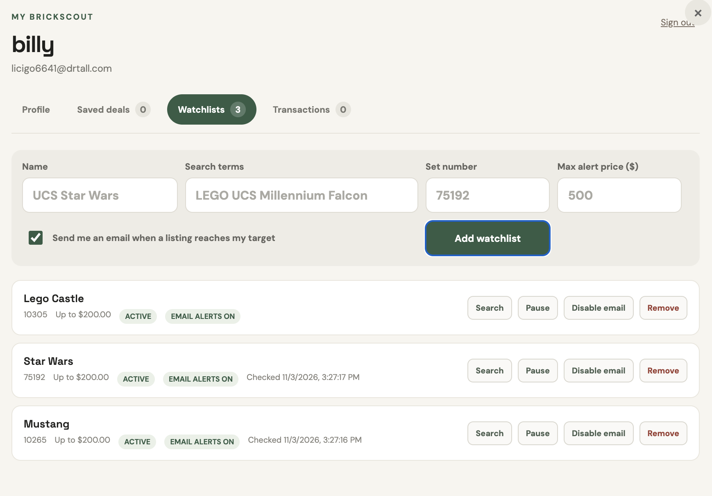
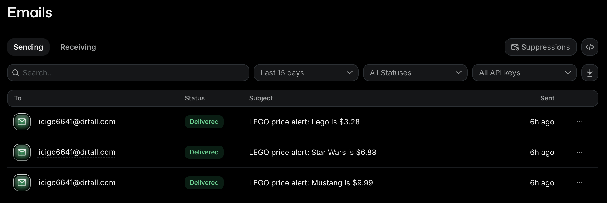
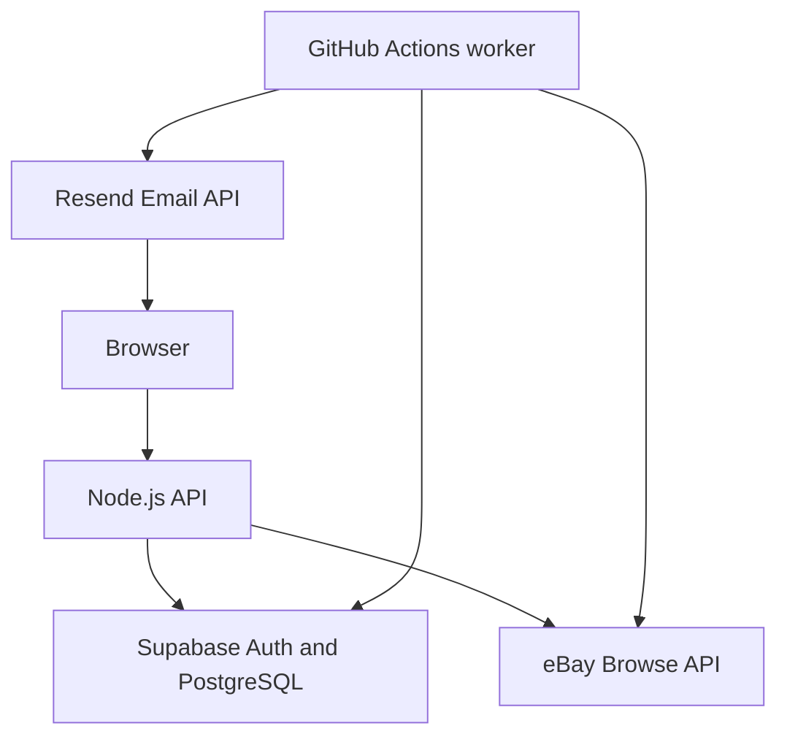

# BrickScout — LEGO Deal Finder

[](https://github.com/herobryyant/Lego-Deal-Finder/actions)


BrickScout is a full-stack LEGO deal finding application that searches live eBay listings, compares shipping-inclusive prices, and notifies users when a watched set reaches their target price.

[View the live demo](https://lego-deal-finder.onrender.com)

> The Render free service may take a short time to wake up on the first request.


## Features

- Search live eBay listings by LEGO set name or set number
- Compare listing price plus shipping
- Calculate the median price of current listings
- Identify listings priced below the current median
- Create and authenticate user accounts
- Save interesting listings
- Create price target watchlists
- Enable or pause individual email alerts
- Receive automated deal notifications through Resend
- Track planned purchases, purchases, and sales
- Prevent duplicate alerts for the same listing and price
- Process eBay Marketplace Account Deletion notifications
- Run automated unit and integration tests through GitHub Actions

## Screenshots

### Search and compare listings


### Manage price watchlists



### Receive automated alerts



## Architecture



### Application flow

1. A user creates a watchlist with a search term, optional set number, and target price.
2. Supabase stores the watchlist and the user’s notification preferences.
3. GitHub Actions runs the price alert worker on a schedule.
4. The worker retrieves active watchlists and searches the eBay Browse API.
5. Shipping-inclusive totals are compared against each target price.
6. Resend sends an email when a qualifying listing is found.
7. The alert is recorded in PostgreSQL to prevent duplicate notifications.

## Technology Stack

### Frontend

- HTML5
- CSS3
- Vanilla JavaScript
- Responsive dialog based account dashboard

### Backend

- Node.js 20
- Native HTTP/API routing
- eBay Browse API
- Resend Email API

### Database and Authentication

- Supabase Auth
- PostgreSQL
- Row-Level Security policies

### Deployment and Automation

- Docker
- Render
- GitHub Actions
- Scheduled price alert worker
- Unit and integration tests

## Local Setup

### Prerequisites

You will need:

- Node.js 20 or newer
- An eBay Developer account
- A Supabase project
- A Resend account
- A verified email domain for Resend

### Clone the repository

```bash
git clone https://github.com/herobryyant/Lego-Deal-Finder.git
cd Lego-Deal-Finder
```

If `package.json` is inside the `test_datebase` directory:

```bash
cd test_datebase
```

### Install dependencies

```bash
npm install
```

### Configure environment variables

Create `.env` beside `package.json`:

```env
PORT=3000
NODE_ENV=development
COOKIE_SECURE=false

EBAY_ENVIRONMENT=production
EBAY_MARKETPLACE_ID=EBAY_US
EBAY_CLIENT_ID=your_ebay_client_id
EBAY_CLIENT_SECRET=your_ebay_client_secret

EBAY_DELETION_VERIFICATION_TOKEN=your_verification_token
EBAY_DELETION_ENDPOINT=http://localhost:3000/api/ebay/account-deletion

SUPABASE_URL=https://your-project.supabase.co
SUPABASE_PUBLISHABLE_KEY=your_publishable_key
SUPABASE_SECRET_KEY=your_server_only_secret_key

RESEND_API_KEY=your_resend_api_key
ALERT_FROM_EMAIL=LEGO Deal Finder <alerts@yourdomain.com>

APP_URL=http://localhost:3000
```

Never commit `.env` or expose `SUPABASE_SECRET_KEY`, `EBAY_CLIENT_SECRET`, or `RESEND_API_KEY` in frontend code.

### Configure Supabase

1. Open your Supabase project.
2. Open **SQL Editor**.
3. Run the SQL migration files in the `supabase/` directory in order.
4. Confirm that the following tables exist:
   - `profiles`
   - `saved_deals`
   - `watchlists`
   - `transactions`
   - `price_alerts`
5. Confirm that Row-Level Security is enabled for user-owned data.

### Start the application

```bash
npm start
```

Open:

```text
http://localhost:3000
```

## Testing

Run all unit and integration tests:

```bash
npm test
```

Run only unit tests:

```bash
npm run test:unit
```

Run the integration smoke test:

```bash
npm run test:integration
```

Manually run the price alert worker:

```bash
node scripts/check-price-alerts.js
```

## Docker

Build the image:

```bash
docker build -t lego-deal-finder .
```

Run it using the local environment file:

```bash
docker run --env-file .env -p 3000:3000 lego-deal-finder
```

Open:

```text
http://localhost:3000
```

## Automated Price Alerts

The scheduled GitHub Actions workflow:

1. Loads active email-enabled watchlists.
2. Searches eBay for matching listings.
3. Rejects listings with unknown shipping or non-USD prices.
4. Selects the least expensive listing under the target price.
5. Sends the user an email through Resend.
6. Records the alert to prevent duplicate notifications.
7. Updates the watchlist’s last-checked timestamp.

The workflow requires these GitHub repository secrets:

```text
SUPABASE_URL
SUPABASE_SECRET_KEY
EBAY_CLIENT_ID
EBAY_CLIENT_SECRET
RESEND_API_KEY
ALERT_FROM_EMAIL
```

## API Overview

| Method | Endpoint | Purpose |
|---|---|---|
| `GET` | `/api/health` | Application health check |
| `GET` | `/api/search` | Search current eBay listings |
| `GET` | `/api/auth/session` | Retrieve the current session |
| `POST` | `/api/auth/signup` | Register a user |
| `POST` | `/api/auth/login` | Sign in |
| `POST` | `/api/auth/logout` | Sign out |
| `GET` | `/api/dashboard` | Load user dashboard data |
| `PUT` | `/api/profile` | Update a user profile |
| `POST` | `/api/saved-deals` | Save a listing |
| `POST` | `/api/watchlists` | Create a watchlist |
| `PATCH` | `/api/watchlists/:id` | Update alert settings |
| `POST` | `/api/transactions` | Record a transaction |
| `GET/POST` | `/api/ebay/account-deletion` | Handle eBay deletion notifications |

## Security

- Secrets are stored in environment variables and GitHub Actions Secrets.
- User-owned database rows are protected with PostgreSQL Row-Level Security.
- The Supabase secret key is restricted to trusted backend workers.
- Authentication cookies can be configured as secure in production.
- eBay deletion notifications are verified before processing.
- User-provided content is escaped before being rendered.

## Future Improvements

- Add historical price charts
- Add alert frequency preferences
- Add email unsubscribe controls
- Add structured application logging
- Add retry handling and idempotency keys for email delivery
- Increase integration and end-to-end test coverage
- Refactor backend routes into separate services and controllers

## Disclaimer

BrickScout is an independent portfolio project and is not affiliated with or endorsed by the LEGO Group or eBay. LEGO is a trademark of the LEGO Group. Listing prices and availability can change at any time.